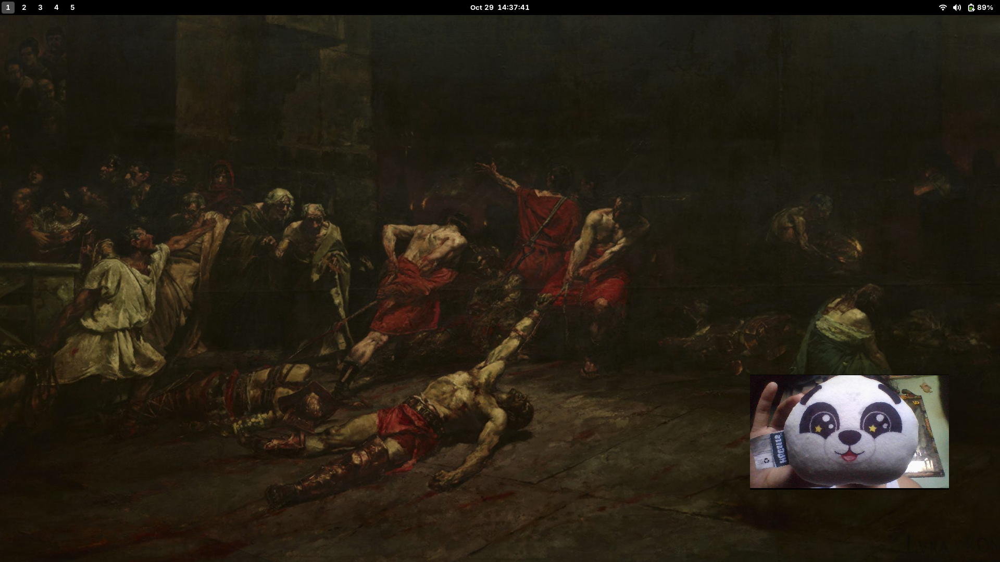

# Frameless Camera

A tiny, mirrored camera preview I built for myself. The window has no title bar,
toolbar, buttons, or other visible interface.



## Why I made this

I made this app because I wanted a webcam window that I could freely move and
resize while recording with OBS. Its frameless design keeps the camera feed
clean, without a title bar, toolbar, or other controls appearing in the
recording. I also made it to learn more about developing applications in C++
with Qt. I use GNOME's built-in option to toggle whether the window appears on
all workspaces or only one.

## Install the build dependencies

```sh
sudo apt update
sudo apt install build-essential curl pkg-config qt6-base-dev qt6-multimedia-dev qt6-wayland
```

## Build and run

```sh
make
./build/frameless-camera
```

You can also build and launch it in one step with `make run`.

## Controls

- Drag anywhere away from an edge to move the window.
- Drag an edge or corner to resize it.

The application uses the system's default camera, starts at 440 × 280, stays
on top of regular windows, fills its entire window with the camera preview, and
mirrors the image horizontally.

On Wayland, the desktop compositor has final control over window positioning
and whether an always-on-top request is honored. The app uses the compositor's
native operations for moving and resizing whenever they are available.

## License

This project is licensed under the [MIT License](LICENSE).
